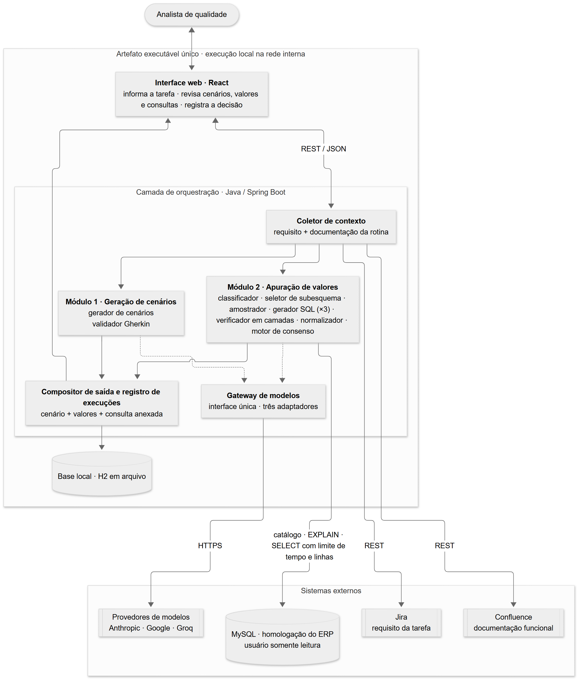

# Plataforma de cenários de teste para ERP

Trabalho de Conclusão de Curso — Análise e Desenvolvimento de Sistemas, UNIMATER (2026–2027).
Autor: Eduardo Krause · Orientador: Prof. Me. João Mazzochin.

## O que é

Plataforma que gera **cenários de teste em Gherkin** a partir do requisito de uma tarefa e da documentação
funcional da rotina, e que **apura os valores esperados por consulta ao banco de dados**, com decisão por
consenso entre modelos de linguagem de três famílias distintas (Claude, Gemini e Llama).

O problema que orienta o trabalho: em relatórios de sistemas de gestão, testar exige conhecer de antemão o valor
que o sistema deve exibir. A plataforma obtém esse valor de forma **verificável, e não inferida**: cada modelo gera
uma consulta de forma independente, as consultas são executadas em modo somente leitura e o valor só é adotado
como referência quando ao menos dois resultados coincidem. A conferência do analista é sempre obrigatória.

## Como vai funcionar

1. O analista informa a chave da tarefa do Jira na interface (pelo assistente).
2. A plataforma busca o requisito da tarefa e, se pedido, a documentação da rotina no Confluence.
3. O **Módulo 1** gera os cenários de teste em Gherkin e valida a sintaxe.
4. Para cada valor que o cenário precisa conferir, o **Módulo 2** pede a consulta SQL a três modelos
   (Claude, Gemini e Llama), cada um de forma independente.
5. As consultas passam por um verificador e são executadas no MySQL de homologação, só leitura, com limite
   de tempo e de linhas.
6. Se pelo menos dois dos três resultados coincidirem, o valor vira a referência do cenário; se não, o
   cenário fica marcado como "valor a apurar".
7. O analista confere os cenários, os valores e as consultas e registra a decisão. Tudo fica gravado para
   auditoria e para as métricas do plano de validação.

## Telas

O protótipo da interface está em [`frontend`](frontend) e roda com dados simulados:

- **Assistente**: conversa para pedir a geração dos cenários de uma tarefa;
- **Execuções**: histórico com busca e filtros;
- **Detalhe da execução**: requisito, andamento, cenários Gherkin com os valores apurados, consulta de cada
  modelo e conferência do analista;
- **Métricas**: indicadores do plano de validação e números por provedor.

## Arquitetura



- **Interface web** (React): informa a tarefa, revisa cenários, valores e consultas, registra a decisão.
- **Orquestração** (Java 21 / Spring Boot 3):
  - coletor de contexto (Jira e Confluence);
  - Módulo 1, geração de cenários com validação Gherkin;
  - Módulo 2, apuração de valores: classificador, seletor de subesquema, amostrador, gerador SQL (×3),
    verificador em camadas, normalizador e motor de consenso;
  - gateway de modelos com um adaptador por provedor;
  - compositor de saída e registro de execuções.
- **Base local** (H2 em arquivo) para auditoria e métricas.
- **MySQL de homologação** acessado só com usuário somente leitura, com limite de tempo e de linhas.

Os diagramas ficam em [`docs/diagramas`](docs/diagramas). Os arquivos `.mmd` são a fonte, e os `.svg` e `.png`
são gerados a partir deles.

```bash
npx @mermaid-js/mermaid-cli -i docs/diagramas/arquitetura.mmd -o docs/diagramas/arquitetura.svg -b white
```

## Planejamento

- [Backlog priorizado](docs/backlog.md), com a fatia vertical marcada.
- [Etapas do TCC](tcc) entregues ao orientador (E1 a E5).
- Fora do escopo: execução automatizada dos testes, automação de interface, geração de massa sintética e
  **qualquer escrita no banco do ERP**.

## Como executar

Por enquanto só existe o protótipo da interface, que roda com dados simulados:

```bash
cd frontend
npm install
npm run dev
```

Detalhes em [`frontend/README.md`](frontend/README.md). As instruções completas entram aqui junto com o
esqueleto (item B01 do backlog).

## Segurança

Credenciais dos modelos, do Jira, do Confluence e do banco são lidas de variáveis de ambiente e nunca são
versionadas (ver `.gitignore`). O banco do ERP não é exposto à rede externa.
